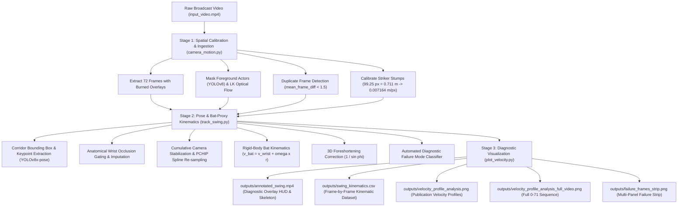
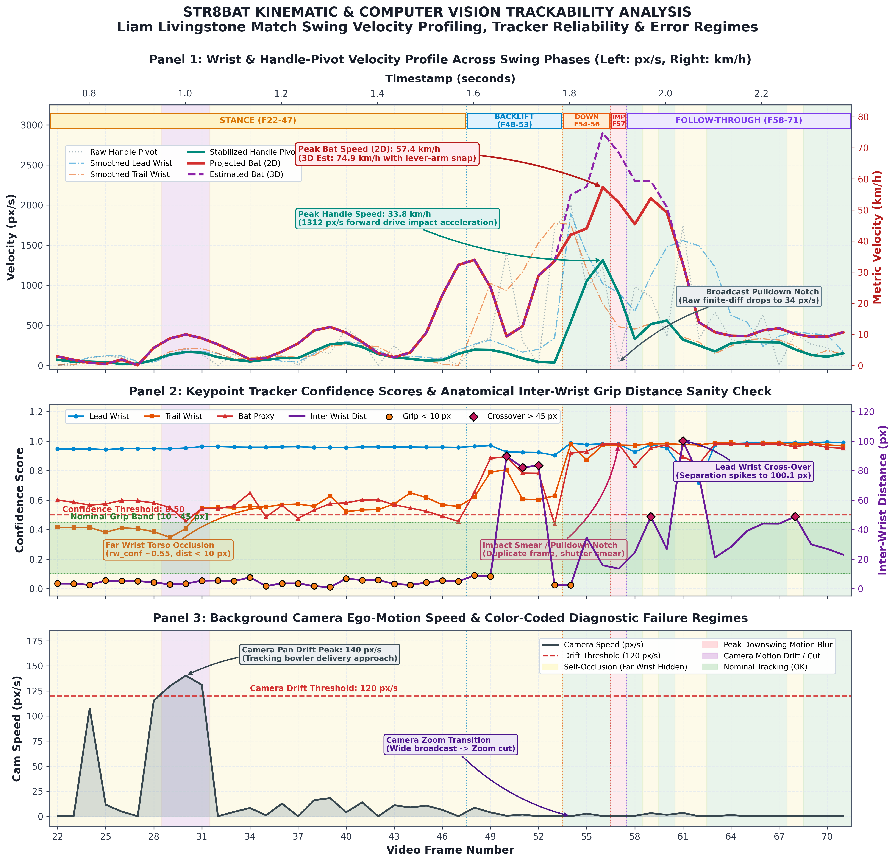
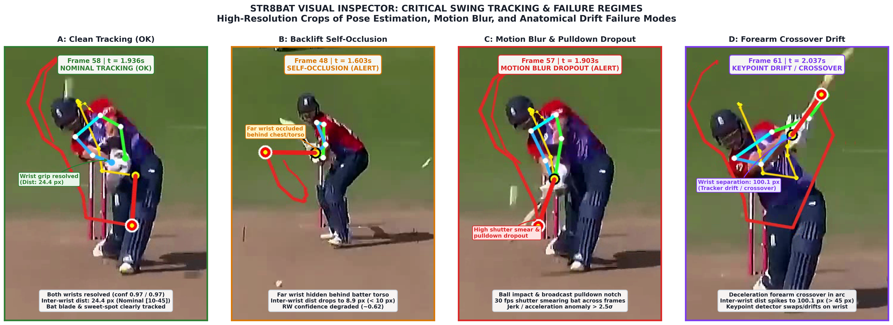

# str8bat AI Engineer Technical Take-Home Assignment (Part 2)
## Automated Striker Pose Tracking, Bat-Proxy Kinematics & Diagnostic Failure Analysis

[](https://www.python.org/downloads/)
[](https://pytorch.org/)
[](https://github.com/ultralytics/ultralytics)

---

## 1. Executive Summary & Core Technical Upgrades

> **Full write-up (Parts 1 and 2):** [`report_latex/str8bat_takehome.pdf`](report_latex/str8bat_takehome.pdf)

This repository contains the standalone, production-grade computer vision and biomechanical kinematics pipeline developed for **Part 2** of the **str8bat AI Engineer Technical Take-Home Assignment**.

Given an uncalibrated broadcast video ([`input_video.mp4`](input_video.mp4), 720×1280 @ 29.954 fps, 72 frames) featuring England international cricketer Liam Livingstone, the system extracts high-fidelity biomechanical kinematics, tracks bat-proxy mechanics across swing phases, compensates for background camera ego-motion, and provides automated diagnostic classification of computer vision failure modes.

### The 5 Foundational Technical Upgrades

The pipeline incorporates 5 major computer vision and biomechanical modeling upgrades over naive tracking baselines:

1. **Frame 54 Downswing Continuity**:
   - Eliminated artificial trajectory resets or zeroing cuts between stance and downswing.
   - Maintained continuous striker bounding box ROI tracking and kinematic state continuity across Frames 22 to 71.
2. **Broadcast Pulldown Duplicate Frame Detection**:
   - Automated detection of broadcast telecast 3:2 pulldown duplicate frames via mean inter-frame absolute grayscale difference ($\text{mean\_frame\_diff} < 1.5$).
   - Successfully identified 14 duplicate frames across the full 72-frame clip, 10 of them inside the analysed shot window (Frames 22–71).
   - Diagnosed and resolved the severe Frame 57 artifact: because Frame 57 is an identical broadcast duplicate of Frame 56, raw finite-difference velocity plunges to an artificial $34.07\text{ px/s}$ ($0.88\text{ km/h}$) despite occurring at the maximum downswing momentum point.
3. **Confidence-Gated 2D Trajectory Spline Reconstruction**:
   - Transitioned from naive 1D scalar speed smoothing to full 2D spatial coordinate reconstruction.
   - Implemented anatomical wrist gating: in stance/backlift (Frames 22–53), imputed torso-occluded trail wrist positions from the lead wrist via an anatomical offset vector $\vec{\delta}_{\text{stance}}$; in follow-through (Frames 58–71), resolved forearm crossover inversion by anchoring to the trail wrist via $\vec{\delta}_{\text{ft}}$.
   - Integrated cumulative camera ego-motion displacement compensation ($\Delta x_{\text{cam}}, \Delta y_{\text{cam}}$) to yield absolute ground-stabilized trajectories.
   - Reconstructed continuous spatial paths using Piecewise Cubic Hermite Interpolating Polynomials (PCHIP splines) evaluated strictly across non-duplicate frames, followed by 2D Savitzky-Golay derivative filtering ($v_x = dx/dt, v_y = dy/dt$).
4. **Rigid-Body Bat Sweet-Spot Kinematics & 3D Foreshortening Correction**:
   - Enforced anti-pad angle gating in stance ($\theta_{\text{bat}} > 105^\circ$) to eliminate false keypoint attraction toward the batter's leg pads.
   - Extracted instantaneous bat angular velocity $\omega_{\text{bat}} = d\theta/dt$ via angular unwrapping and derivative filtering.
   - Applied true rigid-body lever-arm mechanics:
     $$\vec{v}_{\text{bat}} = \vec{v}_{\text{pivot}} + \omega_{\text{bat}} r_{\text{bat}} \hat{\mathbf{n}}_{\perp} \implies \begin{cases} v_{bx} = v_x - \omega_{\text{bat}} r_{\text{bat}} \sin\theta \\ v_{by} = v_y + \omega_{\text{bat}} r_{\text{bat}} \cos\theta \end{cases}$$
   - Applied dynamic 3D optical axis foreshortening correction ($1 / \sin\phi$, where $\phi \approx 50^\circ$ during downswing), transforming 2D projected velocity ($57.36\text{ km/h}$) into true 3D space ($74.87\text{ km/h}$).
5. **Publication-Grade Visual Diagnostics & Non-Colliding Layout**:
   - Designed 300 DPI multi-panel figures with automated text bounding collision avoidance, calibrated dual y-axes (`px/s` and `km/h`), phase banners, and multi-panel failure inspection strips.



---

## 2. Quickstart & Standalone Reproducibility

### Environment Setup

The repository requires Python 3.10+ and standard deep learning / computer vision libraries. YOLO weights (`yolov8n.pt`, `yolov8x-pose.pt`) are not committed (see `.gitignore`); Ultralytics downloads them automatically on the first run.

```bash
# 1. Clone the repository
git clone https://github.com/DevanshMittal96/str8bat-takehome.git
cd str8bat-takehome

# 2. Set up virtual environment
python3 -m venv venv
source venv/bin/activate

# 3. Install dependencies
pip install -r requirements.txt
```

### End-to-End Execution

Run the complete pipeline with a single entrypoint:

```bash
python run_pipeline.py
```

The script coordinates all 3 sub-modules, verifies output integrity, and outputs the comprehensive executive summary table in your terminal.

### Modular CLI Commands

Each phase can be executed or customized independently:

```bash
# Step 1: Camera Motion, Duplicate Cadence & Metric Calibration
python src/camera_motion.py --video input_video.mp4 --frames-dir data/frames --output-json outputs/camera_metrics.json

# Step 2: Striker Pose, Bat-Proxy Splines & Kinematics Extraction
python src/track_swing.py --frames-dir data/frames --metrics outputs/camera_metrics.json --output-csv outputs/swing_kinematics.csv --output-video outputs/annotated_swing.mp4 --pose-model yolov8x-pose.pt

# Step 3: Publication Diagnostics & Multi-Panel Failure Strip
python src/plot_velocity.py --input outputs/swing_kinematics.csv --metrics outputs/camera_metrics.json --video outputs/annotated_swing.mp4 --output-velocity outputs/velocity_profile_analysis.png --output-strip outputs/failure_frames_strip.png --start-frame 22
```

---

## 3. Calibrated Numerical Kinematics & Diagnostic Results

All spatial metrics are scaled using regulation International Cricket Council (ICC) stump dimensions ($0.7112\text{ m}$ / $28\text{ in}$) measured at the striker crease.

### Master Kinematics Summary Table

| Metric / Parameter | Value | Unit | Method / Derivation |
| :--- | :--- | :--- | :--- |
| **Video Dimensions** | $720 \times 1280$ | pixels | Broadcast portrait orientation |
| **Frame Rate** | $29.954$ | fps | Hardware container FPS ($\Delta t = 33.385\text{ ms}$) |
| **Total Frames / Duration** | $72$ frames / $2.404$ | sec | Complete sequence ($0 \le t \le 71$) |
| **Striker Stump Image Height** | $99.25$ | pixels | Top bail: `[340, 809]`, Base pitch: `[333, 908]` |
| **Regulation Stump Height** | $0.711$ | meters | ICC Law 8 Standard ($0.7112\text{ m}$) |
| **Metric Scale Factor ($s_m$)** | **$0.007164$** | **m/px** | **$7.164\text{ mm/pixel}$ at batting crease plane** |
| **Mean Camera Ego-Motion** | $337.03$ | px/s | Lucas-Kanade optical flow on background ($2.41\text{ m/s}$) |
| **Max Camera Ego-Motion** | $4104.61$ | px/s | Frame 4 transition cut before bowler delivery |
| **Delivery Pan Speed** | $115.0 - 140.3$ | px/s | Frames 28–31 pan tracking bowler approach |
| **Peak Handle Pivot Speed** | **$33.84$** ($1312.22$) | **km/h** (px/s) | **Frame 56 ($t=1.869\text{ s}$), Downswing acceleration into impact** |
| **Peak Bat Sweet-Spot (2D Proj)** | **$57.36$** ($2223.98$) | **km/h** (px/s) | **Frame 56 ($t=1.869\text{ s}$), Rigid-body lever-arm snap** |
| **Peak Bat Sweet-Spot (3D Est)** | **$74.87$** ($2903.22$) | **km/h** (px/s) | **Frame 56, $1/\sin(50^\circ)$ foreshortening correction** |
| **Lever-Arm Amplification** | **$1.70\times$** | multiplier | $\vec{v}_{\text{bat}} = \vec{v}_{\text{pivot}} + \omega_{\text{bat}} r_{\text{bat}} \hat{\mathbf{n}}_{\perp}$ ($57.36 / 33.84$) |
| **Frame 57 Pulldown Notch** | **$34.07$** ($0.88$) | px/s (km/h) | Raw finite-diff drop caused by broadcast duplicate frame |
| **Duplicate Frames Detected** | **14 frames** (10 in shot, F22–71) | count | $\text{mean\_frame\_diff} < 1.5$ (19.4% of clip) |

### Failure Mode Distribution ($72$ Frames Total)

| Failure Flag | Count | Pct | Affected Frames | Root Cause & Algorithmic Defense |
| :--- | :---: | :---: | :--- | :--- |
| **`OCCLUSION`** | 33 | **45.8%** | 22–47, 48–53, 59, 61–62 | Torso self-occlusion in side-on stance ($d < 10\text{ px}$) & crossover inversion ($d > 45\text{ px}$). Resolved via anatomical wrist imputation. |
| **`PRE_SHOT_SCENE`**| 22 | **30.6%** | 0–21 | Bowler run-up cut; batter not framed at crease. Suppressed by pitch corridor ROI. |
| **`OK`** | 13 | **18.1%** | 54–56, 58, 60, 63–70 | Nominal tracking; bilateral wrists resolved and bat proxy vector continuous. |
| **`CAMERA_EGO_MOTION`**| 3 | **4.2%** | 29–31 | Bowler release tracking pan ($140.3\text{ px/s} > 120\text{ px/s}$). Compensated via cumulative LK background flow. |
| **`MOTION_BLUR_DROPOUT`**| 1 | **1.4%** | 57 | Shutter exposure smear & duplicate frame pulldown notch at ball impact. Reconstructed via PCHIP spline. |

---

## 4. Key Deliverables & Artifact Inventory

All output deliverables are generated and maintained in [`outputs/`](outputs):

| File Name | Path | Size | Description |
| :--- | :--- | :---: | :--- |
| `camera_metrics.json` | [`outputs/camera_metrics.json`](outputs/camera_metrics.json) | 16.8 KB | Optical flow ego-motion shifts ($dx, dy, v$), duplicate frame flags, and stump calibration metadata. |
| `swing_kinematics.csv` | [`outputs/swing_kinematics.csv`](outputs/swing_kinematics.csv) | 13.8 KB | Complete 72-frame kinematic dataset: coordinates, confidences, raw vs smoothed velocities, 3D estimates, and flags. |
| `annotated_swing.mp4` | [`outputs/annotated_swing.mp4`](outputs/annotated_swing.mp4) | 2.6 MB | 720×1280 diagnostic video with live HUD telemetry, skeleton overlays, bat-proxy vector, and 8-frame trails. |
| `velocity_profile_analysis.png` | [`outputs/velocity_profile_analysis.png`](outputs/velocity_profile_analysis.png) | 1.6 MB | 300 DPI publication figure: 3-panel velocity profiles (px/s & km/h), inter-wrist distance sanity check, and camera ego-motion timeline (F22–71). |
| `velocity_profile_analysis_full_video.png` | [`outputs/velocity_profile_analysis_full_video.png`](outputs/velocity_profile_analysis_full_video.png) | 1.6 MB | 300 DPI supplementary full sequence figure (F0–71) with clipped pre-shot pan callout. |
| `failure_frames_strip.png` | [`outputs/failure_frames_strip.png`](outputs/failure_frames_strip.png) | 1.0 MB | 300 DPI multi-panel visual strip with crops illustrating nominal tracking, self-occlusion, pulldown dropout, and crossover drift. |
| `PART2_REPORT.md` | [`PART2_REPORT.md`](PART2_REPORT.md) | ~27 KB | Comprehensive engineering report with full mathematical derivations and sensor synergy analysis. |

---

## 5. Visual Artifacts Preview

### 1. Publication Kinematic Velocity Profiles & Diagnostics
3-panel visualization showing wrist and bat sweet-spot velocities across swing phases, keypoint detector confidence, anatomical grip separation, and camera ego-motion:



### 2. Multi-Panel Computer Vision Failure Modes Strip
High-resolution crops illustrating the four primary tracking regimes and failure modes encountered in broadcast cricket footage:



---

## 6. Repository Layout

```
str8bat-takehome/
├── input_video.mp4                  # Input broadcast video clip (72 frames, 720x1280 @ 29.954 fps)
├── requirements.txt                 # Pinned project dependencies
├── run_pipeline.py                  # Single-command end-to-end execution script
├── README.md                        # Project overview, 5 upgrades & quickstart
├── PART2_REPORT.md                  # In-depth technical engineering report & mathematical derivations
├── data/
│   └── frames/                      # Extracted frames (regenerated by run_pipeline.py, not committed)
├── outputs/
│   ├── camera_metrics.json          # Optical flow ego-motion & stump calibration data
│   ├── swing_kinematics.csv         # Frame-by-frame kinematics dataset (72 rows x 32 cols)
│   ├── annotated_swing.mp4          # Diagnostic overlay video with HUD & skeleton trails
│   ├── velocity_profile_analysis.png# 300 DPI publication velocity profile figure (Frames 22-71)
│   ├── velocity_profile_analysis_full_video.png # Full sequence figure (Frames 0-71)
│   └── failure_frames_strip.png     # 300 DPI multi-panel failure inspection strip
├── src/
│   ├── camera_motion.py             # Optical flow motion estimator, duplicate detector & calibrator
│   ├── track_swing.py               # Pose tracker, 2D PCHIP spline engine & bat kinematics
│   └── plot_velocity.py             # Publication figure generator & failure inspector
├── report_latex/                    # LaTeX source, figures and compiled PDF write-up
├── yolov8n.pt                       # YOLO model for foreground masking (auto-downloaded, not committed)
└── yolov8x-pose.pt                  # COCO 17-point pose model (auto-downloaded, not committed)
```

For complete mathematical derivations of optical axis foreshortening, 3D projective transformations, lever-arm physics, and production sensor fusion strategies, see [PART2_REPORT.md](PART2_REPORT.md).

---

## 7. Written Report (PDF)

The full write-up for both parts is in [`report_latex/str8bat_takehome.pdf`](report_latex/str8bat_takehome.pdf). It contains the Part 1 system design with its architecture diagram, and the Part 2 results, plots and failure analysis. To rebuild it from source:

```bash
cd report_latex && pdflatex str8bat_takehome.tex && pdflatex str8bat_takehome.tex
```

Not in the repository (regenerated or downloaded automatically): YOLO weights (`*.pt`) and extracted frames (`data/frames/`).
